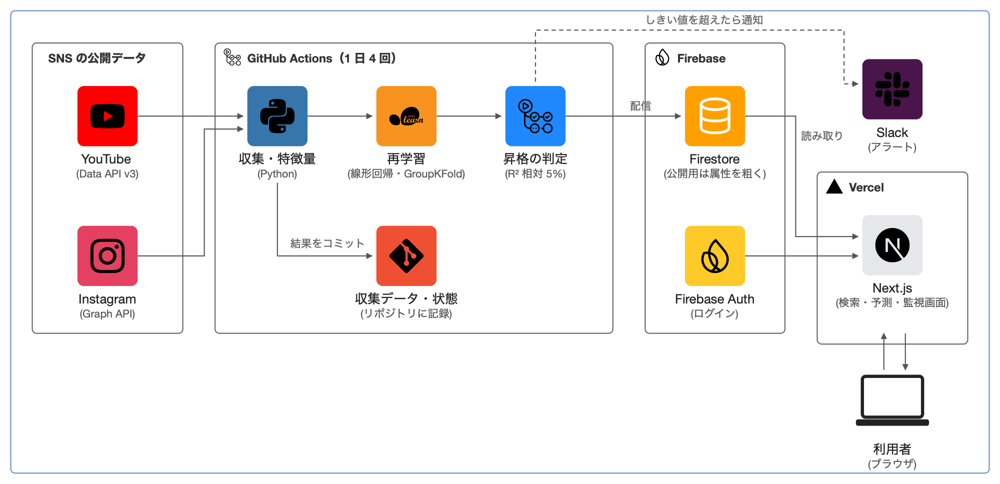

# IndieMatch

フォロワー 1,000〜20,000 人のナノインフルエンサーを探し、費用対効果を見積もるサービス。

- **サービス**: https://indie-matching-v2-azure.vercel.app
- コードは非公開（紹介用のリポジトリ）

## 背景
- 個人開発者・小規模ブランドは、大手のインフルエンサーには頼めない
- ナノ層は数が多く、誰が効果的か見えにくい
- → 公開データを集め、反応（いいね・コメント・再生数）を予測して比べられるようにする

## 構成

- 収集: YouTube Data API v3 / Instagram Graph API（YouTube 718 チャンネル・Instagram 647 アカウント）
- 実行: GitHub Actions で 1 日 4 回（収集 → 特徴量 → 再学習 → 昇格判定 → 配信）
- 学習: scikit-learn の線形回帰・Ridge、アカウント単位の GroupKFold
- 昇格: 現行より R² で相対 5% 以上悪ければ却下（113 回中 15 回却下）
- 配信: Firestore → Next.js（Vercel）、Firebase Auth
- 監視: しきい値アラート（Slack）、モデル監視画面

## 結果: そのモデルに意味があるか
機械学習を使わない基準（過去の中央値など）と、同じ分割・同じ指標で比較。

| 予測 | 基準 | モデル | 差 |
|---|---:|---:|---:|
| Instagram いいね | R² 0.779 | 0.801 | +0.022 |
| Instagram コメント | R² 0.251 | 0.433 | **+0.182** |
| YouTube 再生数 | R² 0.432 | 0.477 | MAE は悪化 |

- いいねは過去の実績でほぼ決まる → モデルを外す候補
- コメントは投稿の中身で変わる → 機械学習が効いている
- 勾配ブースティングより線形回帰が良かった（log 変換で関係がほぼ線形、データが少ない）

## 設計の要点
- GroupKFold: 同じアカウントが学習と検証の両方に入ると精度が高く出すぎる
- 評価はナノ層だけ: 利用者が知りたい範囲で測る
- 個人情報: 識別子は内部だけ、公開用は属性を粗くして再識別を防ぐ
- 検証できない値（Instagram のリーチ）は仮定値と画面に明示
- 候補探しの API 消費を約 190 分の 1 に削減
